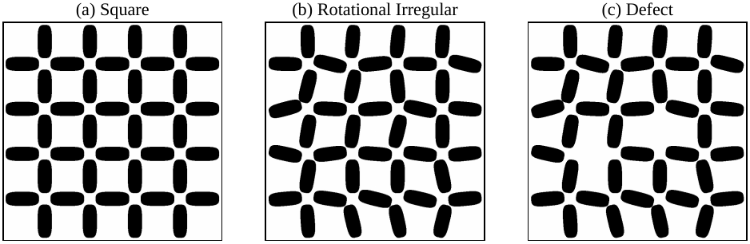
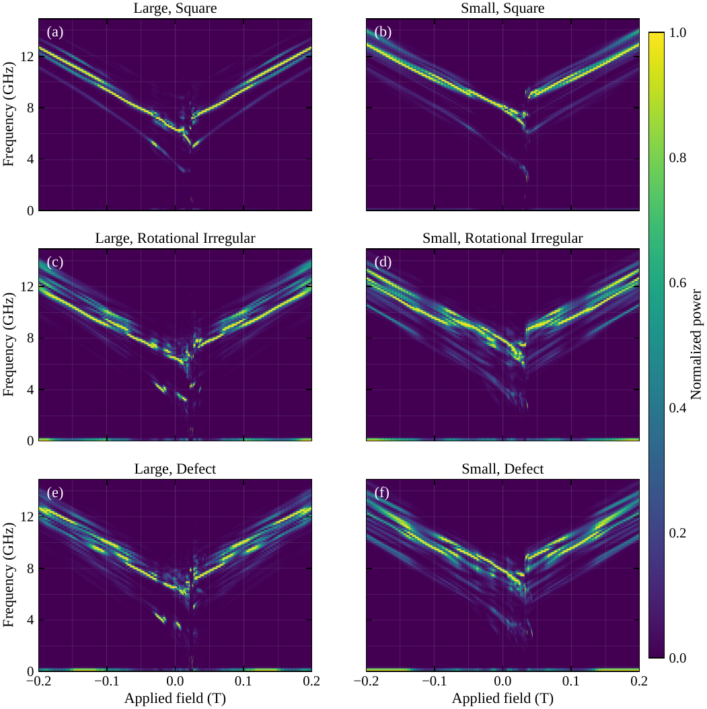
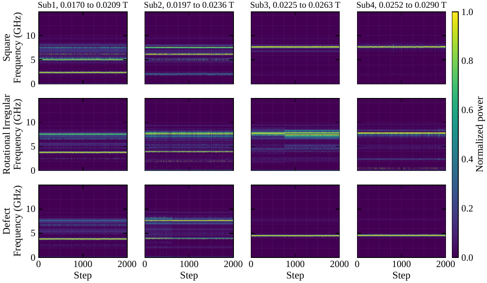
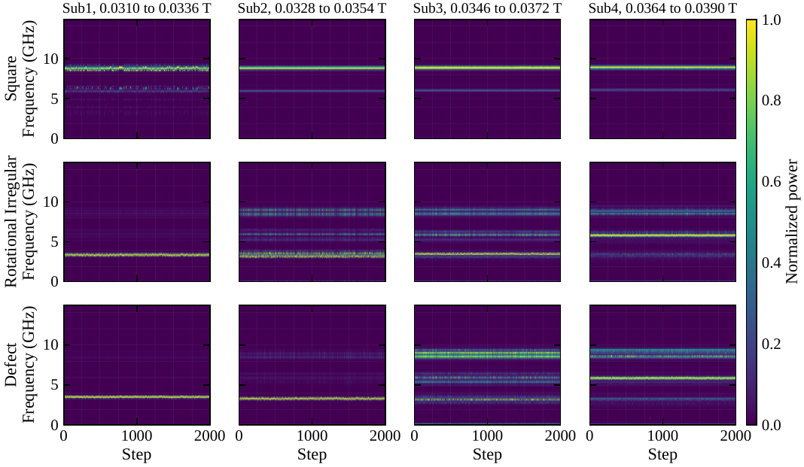

# asi-reservoir-computing

Square artificial spin ice (ASI) as a physical reservoir, simulated in mumax3 and read through ferromagnetic resonance (FMR). This is the code for the ASI part of my MS thesis (University of Kentucky, 2026): geometry generation, benchmark input signals, mumax3 script generation, and FMR heatmaps.

## Results

Simulated artificial spin ice, read through ferromagnetic resonance, is used to explore the effects of altering its geometry, by rotating its islands irregularly with and without missing islands, on its performance as a reservoir. At the Large island size the square array is the most linear in three of four field windows, with a nonlinearity of 0.490 to 0.575 against 0.582 to 0.760 with rotated and missing islands, while the Small size shows no consistent trend. In every geometry the array recalls almost none of its past inputs, with a memory capacity below 0.2, so altering the geometry does not improve its reservoir performance overall.

### Devices

There are two island sizes, Large (610 x 260 x 30 nm in a 4000 nm square window) and Small (430 x 160 x 25 nm in a 3000 nm square window). Each comes in three geometries: Square, Rotational Irregular, and Defect.



Square (a), Rotational Irregular (b), and Defect (c) geometries for the Large island size, with islands in black. The three geometries share one lattice, so they differ only in the rotation of the islands and in the two islands removed in (c).

The switching region of each size is split into four field windows (T). Three geometries in four windows at two sizes give 24 devices.

| Field range | Large | Small |
|---|---|---|
| Switching region | 0.017 to 0.029 | 0.031 to 0.039 |
| Sub1 | 0.0170 to 0.0209 | 0.0310 to 0.0336 |
| Sub2 | 0.0197 to 0.0236 | 0.0328 to 0.0354 |
| Sub3 | 0.0225 to 0.0263 | 0.0346 to 0.0372 |
| Sub4 | 0.0252 to 0.0290 | 0.0364 to 0.0390 |

### FMR heatmaps



FMR spectrum of each device versus applied field over a sweep from −0.2 to +0.2 T, with the power in each column normalized to its maximum, for Square (a), (b), Rotational Irregular (c), (d), and Defect (e), (f), at the Large (left) and Small (right) island sizes. The modes follow the field smoothly except near a small positive field, where islands reverse and the spectrum jumps.



FMR spectrum of each Large device at every step of the Volterra drive, with the power at each step normalized to its maximum, for Square (top), Rotational Irregular (middle), and Defect (bottom) in Sub1 to Sub4 (left to right). Each device holds a few modes at nearly fixed frequencies, with small jumps in some devices, and in Sub3 and Sub4 the Square and Defect devices keep a single mode.



FMR spectrum of each Small device at every step of the Volterra drive, in the same layout as the Large figure above. Small Square keeps two fixed modes near 6.0 and 8.8 GHz in Sub2 to Sub4, while Small Defect gains modes in Sub3 and Sub4.

### Reservoir metrics

NL, MC, and CP of every device under the Volterra drive, for the no-embedding and mixed readouts. NL, MC, and CP use the present spectrum alone (no-embedding readout). Mixed NL, mixed MC, and mixed CP add the previous 10 spectra (mixed readout). The possible range is 0 to 1 for NL, 0 to 30 for MC, 1 to 113 for CP, and 1 to 1243 for mixed CP.

**Large islands, 610 x 260 x 30 nm**

| Window | Geometry | NL | Mixed NL | MC | Mixed MC | CP | Mixed CP |
|---|---|:---:|:---:|:---:|:---:|:---:|:---:|
| Sub1 | Square | 0.490 | 0.491 | 0.143 | 10.12 | 3.97 | 32.6 |
|  | Rotational Irregular | 0.683 | 0.684 | 0.150 | 10.08 | 4.63 | 42.3 |
|  | Defect | 0.657 | 0.658 | 0.176 | 10.14 | 4.42 | 39.1 |
| Sub2 | Square | 0.564 | 0.565 | 0.163 | 10.06 | 4.08 | 35.2 |
|  | Rotational Irregular | 0.760 | 0.760 | 0.067 | 9.97 | 1.18 | 12.7 |
|  | Defect | 0.726 | 0.726 | 0.078 | 1.15 | 5.68 | 18.6 |
| Sub3 | Square | 0.575 | 0.577 | 0.160 | 10.29 | 2.34 | 17.3 |
|  | Rotational Irregular | 0.710 | 0.711 | 0.171 | 10.10 | 4.69 | 48.0 |
|  | Defect | 0.582 | 0.584 | 0.193 | 10.21 | 2.50 | 15.2 |
| Sub4 | Square | 0.835 | 0.834 | 0.071 | 0.05 | 2.74 | 33.2 |
|  | Rotational Irregular | 0.774 | 0.775 | 0.090 | 8.84 | 7.33 | 81.2 |
|  | Defect | 0.827 | 0.826 | 0.063 | 7.82 | 2.29 | 14.5 |

**Small islands, 430 x 160 x 25 nm**

| Window | Geometry | NL | Mixed NL | MC | Mixed MC | CP | Mixed CP |
|---|---|:---:|:---:|:---:|:---:|:---:|:---:|
| Sub1 | Square | 0.934 | 0.933 | 0.181 | 9.81 | 6.35 | 54.0 |
|  | Rotational Irregular | 0.626 | 0.628 | 0.168 | 10.04 | 3.49 | 27.8 |
|  | Defect | 0.664 | 0.667 | 0.131 | 10.18 | 3.01 | 21.3 |
| Sub2 | Square | 0.769 | 0.766 | 0.083 | 10.00 | 1.78 | 7.6 |
|  | Rotational Irregular | 0.709 | 0.711 | 0.134 | 10.06 | 4.34 | 37.8 |
|  | Defect | 0.795 | 0.796 | 0.149 | 10.12 | 3.24 | 27.4 |
| Sub3 | Square | 0.563 | 0.563 | 0.160 | 10.13 | 1.42 | 3.5 |
|  | Rotational Irregular | 0.693 | 0.693 | 0.149 | 10.09 | 4.11 | 33.7 |
|  | Defect | 0.741 | 0.739 | 0.090 | 9.88 | 5.95 | 57.0 |
| Sub4 | Square | 0.612 | 0.613 | 0.159 | 10.11 | 1.41 | 3.4 |
|  | Rotational Irregular | 0.958 | 0.958 | 0.138 | 10.19 | 4.36 | 11.0 |
|  | Defect | 0.726 | 0.726 | 0.161 | 10.12 | 4.99 | 52.2 |

### Prediction

Test NRMSE and CC of every device on NARMA-7 and NARMA-10 prediction and on Mackey-Glass (MG) prediction 8 and 30 steps ahead. NARMA scores use the same 570 test rows. Mackey-Glass scores use 648 test rows at 8 steps and 640 at 30 steps, except Large Defect in Sub4, whose run ended after 1978 steps (640 and 633 rows). Lower NRMSE and higher CC are better.

**Large islands, 610 x 260 x 30 nm**

| Window | Geometry | NARMA-7 NRMSE | NARMA-7 CC | NARMA-10 NRMSE | NARMA-10 CC | MG 8 steps NRMSE | MG 8 steps CC | MG 30 steps NRMSE | MG 30 steps CC |
|---|---|:---:|:---:|:---:|:---:|:---:|:---:|:---:|:---:|
| Sub1 | Square | 0.361 | 0.937 | 0.397 | 0.919 | 0.0060 | 1.0000 | 0.0063 | 1.0000 |
|  | Rotational Irregular | 0.372 | 0.932 | 0.410 | 0.915 | 0.0063 | 1.0000 | 0.0056 | 1.0000 |
|  | Defect | 0.366 | 0.936 | 0.404 | 0.917 | 0.0188 | 0.9998 | 0.0190 | 0.9998 |
| Sub2 | Square | 0.363 | 0.936 | 0.406 | 0.916 | 0.0065 | 1.0000 | 0.0080 | 1.0000 |
|  | Rotational Irregular | 0.375 | 0.932 | 0.456 | 0.893 | 0.0269 | 0.9997 | 0.0380 | 0.9994 |
|  | Defect | 0.444 | 0.929 | 0.401 | 0.918 | 0.0805 | 0.9971 | 0.1244 | 0.9932 |
| Sub3 | Square | 0.365 | 0.937 | 0.394 | 0.920 | 0.0056 | 1.0000 | 0.0054 | 1.0000 |
|  | Rotational Irregular | 0.375 | 0.932 | 0.402 | 0.919 | 0.0116 | 0.9999 | 0.0138 | 0.9999 |
|  | Defect | 0.368 | 0.935 | 0.411 | 0.916 | 0.0058 | 1.0000 | 0.0081 | 1.0000 |
| Sub4 | Square | 0.358 | 0.938 | 0.414 | 0.912 | 0.0919 | 0.9960 | 0.0923 | 0.9957 |
|  | Rotational Irregular | 0.364 | 0.936 | 0.406 | 0.916 | 0.0085 | 1.0000 | 0.0088 | 1.0000 |
|  | Defect | 0.370 | 0.931 | 0.414 | 0.912 | 0.0065 | 1.0000 | 0.0102 | 0.9999 |

**Small islands, 430 x 160 x 25 nm**

| Window | Geometry | NARMA-7 NRMSE | NARMA-7 CC | NARMA-10 NRMSE | NARMA-10 CC | MG 8 steps NRMSE | MG 8 steps CC | MG 30 steps NRMSE | MG 30 steps CC |
|---|---|:---:|:---:|:---:|:---:|:---:|:---:|:---:|:---:|
| Sub1 | Square | 0.371 | 0.932 | 0.409 | 0.913 | 0.1067 | 0.9957 | 0.1333 | 0.9913 |
|  | Rotational Irregular | 0.372 | 0.934 | 0.416 | 0.912 | 0.0062 | 1.0000 | 0.0071 | 1.0000 |
|  | Defect | 0.368 | 0.935 | 0.405 | 0.916 | 0.0079 | 1.0000 | 0.0091 | 1.0000 |
| Sub2 | Square | 0.364 | 0.935 | 0.395 | 0.920 | 0.0879 | 0.9962 | 0.1346 | 0.9912 |
|  | Rotational Irregular | 0.374 | 0.932 | 0.403 | 0.917 | 0.0088 | 1.0000 | 0.0123 | 0.9999 |
|  | Defect | 0.373 | 0.933 | 0.392 | 0.921 | 0.0059 | 1.0000 | 0.0072 | 1.0000 |
| Sub3 | Square | 0.368 | 0.935 | 0.402 | 0.918 | 0.0913 | 0.9958 | 0.1151 | 0.9935 |
|  | Rotational Irregular | 0.373 | 0.933 | 0.398 | 0.919 | 0.0060 | 1.0000 | 0.0066 | 1.0000 |
|  | Defect | 0.380 | 0.930 | 0.401 | 0.919 | 0.0125 | 0.9999 | 0.0147 | 0.9999 |
| Sub4 | Square | 0.360 | 0.938 | 0.400 | 0.919 | 0.0843 | 0.9966 | 0.1207 | 0.9930 |
|  | Rotational Irregular | 0.369 | 0.934 | 0.402 | 0.918 | 0.0079 | 1.0000 | 0.0087 | 1.0000 |
|  | Defect | 0.367 | 0.935 | 0.404 | 0.917 | 0.0100 | 1.0000 | 0.0106 | 0.9999 |

## Pipeline

1. `asi_geometry_generator.py`  build the ASI lattice as a PNG mask
2. `rc_benchmark_generator.py`  make the field-sweep signals that drive the sim
3. `mumax_script_generator.py`  write the mumax3 `.mx3` script from a signal and a geometry
4. *(mumax3)*  run the script, which saves one ringdown table per step
5. `FMR_heatmap.py`  turn the ringdown tables into FMR heatmaps and `fmr_data.npz`
6. `fmr_reservoir_metrics.py`  NL, MC and CP of every device
7. `ASI_NARMA_prediction.py`, `ASI_MG_Prediction.py`  NARMA-7, NARMA-10 and Mackey-Glass prediction

Steps 1 and 2 are independent, run them in either order. Step 3 needs both. Steps 6 and 7 read the `fmr_data.npz` of every run and the `.mx3` next to its `.out` folder.

## Requirements

Python 3 with:

```
pip install numpy matplotlib pillow pandas
```

mumax3 is separate, grab it from mumax.github.io. You run the `.mx3` scripts in mumax3 yourself. These Python scripts just make the inputs and read the outputs.

## 1. asi_geometry_generator.py

Builds a square ASI lattice and saves it as a black-on-white PNG that mumax3 loads as geometry.

Edit the block at the top:
- island size, film size, lattice spacing, cellsize (all nm)
- `disorder_mode`: `"row"`, `"zone"`, `"cluster"`, or `"custom"`
- `global_misalignment`: rotate the whole lattice
- `deleted_islands`: knock out islands by (row, col) for defect studies

Run:

```
python asi_geometry_generator.py
```

You get a PNG named after the settings. It also prints the grid layout so you can read off the (row, col) of every island before deciding which ones to misalign or delete. In row mode with deletions you get two PNGs: a BEFORE (full lattice) and an AFTER (islands removed).

## 2. rc_benchmark_generator.py

Generates the four benchmark signals as field tables: Mackey-Glass, NARMA10, NARMA7, Volterra. Each signal is scaled so its smallest value sits at the bottom of the field window and its largest at the top.

Edit at the top:
- `FIELD_MIN` / `FIELD_MAX`: the field window. Read the switching region off the FMR dispersion heatmap from step 5 (where the modes split or merge).
- `N_POINTS`: number of steps (2000 by default)

Run:

```
python rc_benchmark_generator.py
```

Out: `mackey_glass_table.txt`, `narma10_table.txt`, `narma7_table.txt`, `volterra_table.txt` (two columns, time and field), plus a preview PNG of all four signals.

First time through you won't have a heatmap yet, so use the default field range, run a sweep, look at the dispersion, then come back and set `FIELD_MIN`/`FIELD_MAX` to the switching region.

## 3. mumax_script_generator.py

Writes the `.mx3` script for one signal on one geometry. Every field value in the table becomes one step:

1. relax at +45°, equilibrate
2. relax at −45°, equilibrate
3. 0.1 mT out-of-plane pulse for 20 ps
4. record the ringdown (250 samples, 30 ps apart) to `table_step_XXXX_B_XXXXXXT.txt`

Edit at the top:
- `FIELD_TABLE`, `TASK`, `REGION`, `FIELD_MIN` / `FIELD_MAX`: the signal table from step 2 and its window
- `GEOMETRY_PNG`, `ISLAND_NM`, `FILM_NM`, `GRID`: the geometry from step 1
- `MSAT`, `AEX`: material (permalloy by default)
- field angle, damping for relax, equilibration and ringdown, equilibration time, pulse, ringdown sampling

Run:

```
python mumax_script_generator.py
```

Out: `asi_fmr_<task>_<geometry>_<region>.mx3`. Put it in the same folder as the geometry PNG and run it in mumax3.

## 5. FMR_heatmap.py

Reads the per-step ringdown tables mumax3 writes and turns them into FMR heatmaps.

Point it at your mumax3 output folder:
- `INPUT_FOLDER`: the `.out` folder full of `table_step_XXXX_B_XXXXXXT.txt` files
- `FREQ_MIN` / `FREQ_MAX`: frequency range for the heatmaps (GHz)
- `SAVE_INDIVIDUAL_PLOTS`: set `False` to skip per-step spectra and run faster

Run:

```
python FMR_heatmap.py
```

Out (in `fmr_heatmap/` inside the `.out` folder):
- `FMR_dispersion_field_sorted.png`: modes vs field, the one you use to set the field window in step 2
- `temporal_response.png`: spectrum vs step index, the RC-relevant view
- `input_waveform.png`: the driving signal
- `fmr_data.npz`: fields, step indices, frequencies and power spectra, read by steps 6 and 7

## Folder layout for steps 6 and 7

The analysis scripts expect one folder per island size with one folder per field window inside it:

```
UK Sub regions/
  UK Sub1 Mumax (0.031 - 0.0336)/
    asi_fmr_UK_volterra_square_sub1.mx3
    asi_fmr_UK_volterra_square_sub1.out/fmr_heatmap/fmr_data.npz
    ... (every benchmark x 3 geometries)
  UK Sub2 Mumax .../
  ...
```

The task and the window are read from the run names, so keep `mackey_glass`, `narma7`, `narma10` or `volterra` and `sub1` to `sub4` in them. The full-precision fields and the field window come from the `.mx3` header.

## 6. fmr_reservoir_metrics.py

Nonlinearity (NL), memory capacity (MC) and complexity (CP) from the FMR spectra, following Love et al. (arXiv:2108.01512), for two readouts:
- no embedding: the present spectrum alone
- mixed: the present spectrum plus the previous 10 (Ti et al., arXiv:2412.04622)

Each is scored on a 75 / 25 train/test split and with no split. Set `INPUT_FOLDER` and run:

```
python fmr_reservoir_metrics.py
```

Out (in `fmr_results/<window>/<benchmark>/`): `metrics.csv` plus the readout settings, the memory curve by delay, the NL of every coordinate, the CP singular values, and `memory_profiles.png`.

## 7. ASI_NARMA_prediction.py and ASI_MG_Prediction.py

Ridge readouts of the FMR spectra, split in time order into fit, validation (to pick the ridge alpha) and test.
- `ASI_NARMA_prediction.py`: computes the NARMA-7 and NARMA-10 targets from the input field and predicts them at the same step from the present and previous 7 or 10 spectra.
- `ASI_MG_Prediction.py`: forecasts the Mackey-Glass input field 1 to 64 steps ahead from the present and previous 50 spectra.

Set `INPUT_FOLDER` and run:

```
python ASI_NARMA_prediction.py
python ASI_MG_Prediction.py
```

Out (in `narma7_imitation_runs/`, `narma10_imitation_runs/`, `mg_prediction_runs/`, one folder per run): test metrics, the chosen ridge alpha and split sizes, every prediction, and timeline plots.

## Typical run

1. Generate a geometry PNG.
2. Generate field tables with the default range.
3. Write the `.mx3` script and run the sweep in mumax3.
4. Run `FMR_heatmap.py` and look at the dispersion.
5. Set `FIELD_MIN`/`FIELD_MAX` to the switching region, regenerate the tables and scripts, rerun.
6. Run `FMR_heatmap.py` on every run, then the metric and prediction scripts.
